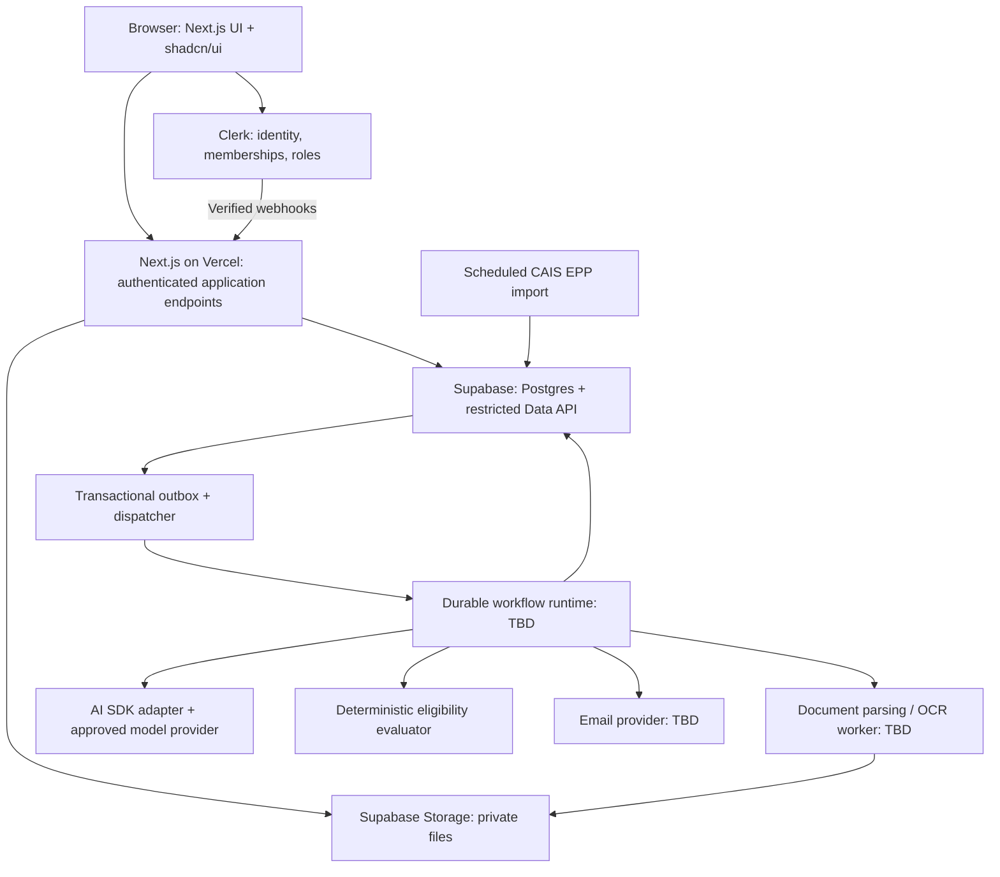

# EuroTender Architecture

Status: architecture approach accepted on 2026-10-31; implementation details and explicitly open decisions remain unresolved.

This document separates confirmed technology and architecture decisions from unresolved choices. Acceptance establishes the target design; it does not mean the integrations are implemented or validated. It does not expand the MVP scope defined in [Requirements.md](./Requirements.md). Product context is in [Project-Description.md](./Project-Description.md).

## 1. Decision register

| Area | Status | Direction |
|---|---|---|
| Web application | Confirmed | Next.js |
| UI components | Confirmed | shadcn/ui |
| Web deployment | Confirmed | Vercel |
| Authentication | Confirmed | Clerk |
| User roles and permissions | Confirmed | Clerk, with application and database enforcement |
| Database | Confirmed | Supabase Postgres |
| File storage | Confirmed | Supabase Storage |
| API layer | Decided | Next.js is the initial browser-facing backend-for-frontend, backed by Supabase persistence and its Data API; restricted direct browser access remains optional |
| Billing | Candidate, not confirmed | Consider Clerk Billing for a later release; MVP invoicing remains manual |
| Application structure | Decided | Modular monolith with asynchronous workflows and replaceable infrastructure adapters |
| Background processing | Decided | Durable, event-triggered workflows; not fire-and-forget tasks attached to web requests |
| Model integration | Decided | Vercel AI SDK for typed model calls and structured extraction |
| AI execution model | Decided | Controlled extraction and evidence-verification workflow, not a general-purpose autonomous agent |
| Analysis and eligibility | Decided | Analyze each tender revision/configuration once and reuse it; evaluate eligibility per company with deterministic rules |
| Reliable event publication | Decided | Transactional outbox with at-least-once delivery and idempotent consumers; no full event sourcing |
| Organization mapping | Decided | One paying organization maps to one Clerk Organization; participating companies remain application entities |
| Initial search | Decided | Postgres filters and conventional full-text/document search; semantic search remains deferred |
| Workflow runtime | Open | Evaluate Vercel Workflow, Inngest, and Trigger.dev against operational and residency requirements |
| AI model/provider | Open | Select through Bulgarian procurement-document evaluation and EU-provider compliance checks |
| AI Gateway | Optional, not confirmed | Use only if routing, retention, and residency satisfy the requirements |
| Document parsing/OCR runtime | Open | Benchmark real documents before choosing parsers, OCR tools, and worker hosting |

The repository currently has a Bun/Turborepo workspace, a Next.js application in `apps/web`, and shared UI/configuration packages. These are scaffolding, not evidence that Clerk, Supabase, or the processing pipeline is already integrated.

### Accepted approach

The decisions above adopt the workflow-first proposal: events trigger durable processing; AI extracts and summarizes evidence; domain code makes eligibility decisions. Company profile revisions affect company assessments, while organization name or membership changes do not by themselves trigger AI analysis. Public tender analysis remains separate from private company data.

Vercel Workflow is the first runtime to prototype, not the selected production runtime. The model/provider, gateway, parsing/OCR tools, worker hosting, email provider, and future billing provider remain unselected. The evaluation and compliance gates below still apply.

## 2. Decided system shape

Start with one application codebase organized by business capability, not separate microservices for every feature. Background execution may use a separate runtime without turning each module into a network service.

The diagram is a logical design, not a commitment to a particular queue, worker vendor, or database schema. Authentication, persistence, model calls, and workflow scheduling are infrastructure details behind application boundaries.

## 3. Business modules and boundaries

| Module | Owns | Requirements |
|---|---|---|
| Identity and access | Clerk integration, membership context, owner/member checks, separate platform-admin access | ACC-02 through ACC-04 |
| Organizations and companies | Paying organization, participating companies, limits, active company, deletion workflow | ACC-01, ACC-05 through ACC-08 |
| Tender ingestion | CAIS EPP polling, canonical metadata, tender revisions, change history, award-notice collection | ING |
| Document processing | Downloads, immutable file versions, parsing/OCR, document status, source locations | DOC |
| Tender analysis | Structured extraction, Bulgarian summaries, verified evidence, construction-specific analysis | AI |
| Company profiles | Structured facts, profile revisions, pilot setup, fact search | PRO |
| Eligibility | Requirement evaluation, readiness, compatibility percentage, result freshness, top matches | QUA |
| Discovery and tender views | Search, saved searches, document search, assembled tender page | SRC, TEN |
| Monitoring and notifications | Shared company bookmarks, digests, preferences, scheduled reminders | MON, BMK |
| Administration and operations | Limits, retries, usage, processing health, AI costs, legal pages, manual billing | ADM |

Dependencies should point toward application use cases and domain rules:

- Eligibility rules accept plain typed facts and requirements, not Clerk sessions, Supabase responses, or model SDK objects.
- Application use cases define the contracts they need for persistence, files, events, model extraction, and email delivery.
- Supabase, Clerk, CAIS EPP, AI SDK, and workflow adapters implement those contracts.
- Next.js endpoints and workflow handlers translate their input into the same use cases.
- The web application and worker entrypoints wire concrete dependencies. Avoid a generic repository framework or a large dependency-injection system unless complexity warrants it.

### Architecture diagnostic

Accepted target design: **9/10**, with all seven dependency-rule checks intended to pass: framework-free business tests, inward imports, replaceable persistence, delivery-independent use cases, infrastructure at the edges, acyclic module dependencies, and entrypoint-owned composition. This is a design assessment, not a verified score for the current code. No failed design rows are identified; implementation tests and import-boundary checks must establish whether the intended boundaries actually hold.

## 4. Identity, tenancy, and permissions

### Organization is not company

Map one paying EuroTender organization to one Clerk Organization. Its participating companies remain separate application entities in Supabase, not additional Clerk Organizations.

Clerk owns users, authentication, organization membership, and roles. Supabase owns company profiles, saved searches, bookmarks, preferences, assessments, and organization limits. Local identity/membership records are synchronized projections, not a second independent identity system.

Map the product owner/member roles to appropriate Clerk roles or custom roles. Platform administrator is a separate platform-wide privilege and must not be inferred from being an organization owner.

The company selector provides context, not authorization. Every read, mutation, export, count, and notification must establish the organization, company ownership, and applicable permission server-side. Cache keys and invalidation must include tenant/company context for sensitive results.

**Unresolved access interpretation:** ACC-07 requires company isolation, but does not specify whether every organization member can switch to every company or needs per-company access grants. Do not infer company access merely from a supplied company ID. Settle this before finalizing authorization policies.

### Clerk and Supabase integration

Use Supabase's supported Clerk third-party-auth integration with Clerk session tokens. Do not start with the deprecated shared-JWT-secret/JWT-template integration, and do not add a parallel Supabase login system.

- Enable row-level security on every exposed table, including tables used through the Data API.
- Enforce tenant ownership and allowed operations in policies; being authenticated alone is insufficient.
- Clerk user identifiers are strings, not Supabase Auth UUIDs. Policies must use the verified Clerk claims and explicit mappings rather than assuming `auth.uid()` identifies a Clerk user.
- Validate current session-claim shapes when implementing; do not assume organization roles or custom permissions have a particular JWT layout.
- Keep internal jobs, event records, and privileged administration out of the public Data API.
- User requests should use user-scoped database access wherever practical. A server-side service credential bypasses RLS and therefore requires explicit authorization; never send it to the browser.
- Webhooks must be signature-verified, durably recorded, deduplicated, and reconciled against authoritative Clerk state when ordering is uncertain.
- Sensitive access and deletion flows must account for stale tokens and delayed membership webhooks. A local lifecycle block should prevent further access/work while deletion proceeds.

No Clerk Organizations, Billing, or instance settings are enabled by this document.

## 5. API responsibilities

Use Next.js as the initial browser-facing backend-for-frontend, backed by Supabase persistence and its Data API.

| Operation | Entrypoint |
|---|---|
| Tender search and page composition | Next.js server-side reads using authorized Supabase queries |
| Company/profile/bookmark mutations | Next.js application use cases with validation, authorization, and transactional event creation where needed |
| Explicit Analyze / Check eligibility | Authorized Next.js command that records/enqueues work and returns job status; no long-running model call in the request |
| Clerk webhooks | Dedicated Next.js endpoint with signature verification and durable inbox processing |
| File download | Authorized file access or short-lived signed URL from private Storage |
| Internal processing | Workflow/worker handlers invoking application use cases |
| Selected direct browser reads or progress updates | Optional Supabase Data API/Realtime, only after equivalent RLS and revocation behavior are tested |

Supabase remains an API layer even when the browser accesses it through Next.js. Avoid two independently implemented sets of business rules across Next.js and database APIs. Transactions and constraints may live in Postgres; core eligibility rules should remain independently testable.

Use pooled connections for direct Postgres access from serverless runtimes. Choose the transaction mechanism during implementation; several sequential REST calls are not an atomic database transaction.

## 6. AI: workflows first, agents only where useful

### Separate three concepts

1. **Events** state that something happened, such as a tender revision being imported.
2. **Workflows** prescribe the steps to execute, persist progress, and recover after failure.
3. **Agents** let a model choose tools and the next action in a loop.

EuroTender needs the first two from the start. Its current requirements do not require the third as the central abstraction.

Use a controlled processing pipeline containing model calls. Do not give one general-purpose agent responsibility for deciding what to ingest, whose private files to read, whether a bidder qualifies, or whom to email.

### Why the AI SDK fits

The Vercel AI SDK provides a TypeScript model-integration layer with provider adapters, structured outputs, and optional tool calling. It can be used independently of Vercel AI Gateway or a Vercel-hosted worker.

Use schema-validated outputs for tender analysis and requirement extraction. Valid JSON does not establish factual correctness: add evidence verification and domain checks after generation. Persist the result only after those checks, with explicit partial/failure states where appropriate.

The SDK is not a queue, scheduler, durable workflow engine, document parser, OCR system, or model provider. Those remain separate choices.

### Decided tender-analysis workflow

1. Import official metadata and identify a new tender or revision.
2. Download documents into private storage with version identifiers, hashes, and timestamps.
3. Parse supported formats; apply OCR where needed. Preserve document/section/page or sheet references and text locations.
4. Produce explicit processed, failed, or skipped document states. Completion does not imply that every file succeeded.
5. Apply the agreed automatic-analysis policy, or honor an authorized manual request.
6. Extract typed requirements and analysis fields with source references. Process large document sets in bounded sections, then reconcile across documents; do not assume every tender fits one model context.
7. Verify quotations against the exact document/text version. OCR-derived quotations need linkage to the original image/page and a defined verification policy. Suppress unverifiable quoted evidence and flag the associated value; the requirement is 100% verifiable displayed quotations, not plausible-looking citations.
8. Apply official-metadata precedence and flag disagreements. Assemble the Bulgarian analysis with its disclaimer and original-document links.
9. Publish a completed analysis revision and request company eligibility checks.

An exact quotation proves that text exists, not that the extracted conclusion is correct. Evaluation must also check that the quotation supports the value and that requirements, alternatives, and relevant dates were interpreted correctly.

### Analyze once, evaluate per company

Public tender analysis is reusable across companies. Store it per tender/document revision and analysis configuration, without company-specific context.

Eligibility assessments are private and specific to a company profile revision and tender analysis revision. Deterministic code evaluates numbers, currencies, validity dates, periods, known alternatives, readiness, and compatibility. Unsupported conditions remain "needs review"; model-assessed similarity is advisory and cannot independently mark eligibility as met.

For QUA-07, every company is checked against newly analyzed tenders. Do not introduce a relevance prefilter that silently omits required company assessments. A relevance filter may control which tenders are analyzed automatically under AI-01 if the founders select that policy.

Company profile edits invalidate that company's affected assessments, not the shared tender analysis. Tender changes invalidate dependent analysis/assessments while retaining the previous visible result until replacement is ready.

**Optional later agent:** A bounded, read-only evidence-finding loop could select sections of a large tender or find conflicting clauses. It would have fixed budgets, scoped tools, and validated outputs. It would not replace the eligibility evaluator or acquire unrestricted database access.

### Documents are untrusted input

Treat instructions embedded in tender files as data, not system instructions. Keep credentials and unrelated tenant data out of prompts. Allowlist any tools, scope them before model execution, and prevent model-controlled URLs or file paths from reaching arbitrary network/storage resources. A parser or model never authorizes access.

Legacy `.doc`, spreadsheets, scanned PDFs, and ZIP files need real parser coverage. Apply archive size/depth limits, path-traversal protection, malware handling, and bounded CPU/memory. A ZIP upload is not a single model-readable document.

## 7. Event-driven execution

Use a transactional outbox, not a full event-sourced application. Postgres remains the source of current business state; events trigger derived work.

Commit the business update and its outbox event in one database transaction. A dispatcher claims pending events, submits work to the chosen runtime, and records delivery. If the process fails between submission and marking delivery, duplicate delivery is expected and must be safe.

Use at-least-once delivery, explicit idempotency, bounded retries/backoff, failed-job visibility, and administrator replay. Events carry identifiers and revisions rather than private document text or complete company profiles.

The following are proposed internal event/command names, not Clerk webhook names:

| Trigger | Consumer/action |
|---|---|
| `tender.imported` / `tender.revised` | Fetch/process changed files, mark dependent results stale, apply analysis policy |
| `analysis.requested` | Run authorized on-demand analysis using the same pipeline |
| `analysis.completed` | Schedule company-specific eligibility assessments |
| `company.profile.revised` | Mark affected assessments stale; schedule recalculation according to the agreed policy |
| `eligibility.requested` | Evaluate the specified company and tender revisions |
| `saved-search.changed` | Refresh deterministic search monitoring; reconsider analysis relevance only if policy requires it |
| `organization.synced` / `membership.synced` | Synchronize access/context; no AI analysis merely because a name or member changed |
| `bookmark.changed` / `tender.deadline.changed` | Update monitoring and reminder scheduling |
| `organization.deletion.requested` | Block new access/work, cancel jobs where possible, purge private data and reconcile deletion |

Creation of an organization without any company facts is not meaningful matching input. Company facts, not organization identity metadata, should drive profile-dependent work.

### Replay and concurrency rules

- Deduplicate model work by tender revision, document set, model configuration, prompt version, and extraction schema version.
- Deduplicate assessments by company/profile revision, analysis revision, and evaluator version.
- Check current entity lifecycle and revisions before publishing results. A late job must not replace a newer result or recreate deleted data.
- Apply concurrency and spend controls globally and per tenant; automatic batch processing must not monopolize capacity needed by explicit requests.
- Record event, correlation, and job identifiers; expose operational failure rather than returning a success-shaped empty analysis.
- Durable retries cannot guarantee exactly one external model call if a response is lost before it is persisted. Track attempts and costs; use provider idempotency where available.
- Reminder delivery needs stable business identifiers, current-deadline checks, preference checks, and provider idempotency/reconciliation. An application lock alone does not prove "never send twice" across a crash after the email provider accepts a request.

Do not rely on in-memory queues, browser activity, Supabase Realtime subscriptions, or a request lifecycle to deliver critical background work.

## 8. Choosing the background runtime

| Candidate | Reason to evaluate | Important validation |
|---|---|---|
| Vercel Workflow | Fits the Vercel/Next.js direction; supports durable steps and resumption | Current production support, deployment/versioning behavior, step limits, observability, data residency, and parser integration |
| Inngest | Event-triggered durable execution with step retries and operational tooling | Hosting/data regions, quotas, payload retention, integration complexity, and runtime limits |
| Trigger.dev | Durable task execution with managed worker infrastructure; useful for heavier background tasks | Worker resources and dependencies, regional availability, costs, retention, and local development |
| Supabase queues plus custom workers | Consolidates durable queue state with Supabase | The team owns worker deployment, retries, scheduling, supervision, replay, and observability |

**Decided evaluation sequence:** Prototype the Vercel Workflow path first because it fits the confirmed web stack, but do not select a production runtime solely for vendor consistency. Use real `.doc`, ZIP, spreadsheet, and scanned-PDF samples to establish whether a separate parsing worker is needed. Compare Inngest or Trigger.dev if workflow operations or worker requirements make them a better fit. Choose one orchestration owner rather than layering multiple workflow engines.

Vercel web deployment does not require every parser or worker to run inside the web application's function runtime. Check current duration, memory, payload, and dependency limits for the actual selected runtime and plan.

## 9. Persistence, search, and operations

These are logical data responsibilities, not a finalized table/schema design:

- Organization mappings, lifecycle status, membership projections, company ownership, and administered limits.
- Company facts and revisions; company-scoped saved searches, bookmarks, notification preferences, and eligibility assessments.
- Shared canonical tenders, official metadata revisions, history, award notices, and immutable document references.
- Parsed document versions and evidence locations; analysis revisions and model/prompt/schema provenance.
- Webhook inbox, outbox events, jobs/attempts, AI usage, reminder schedules, and delivery records.

Use constraints to preserve company/organization consistency and uniqueness for external IDs and replay keys. Index tenant lookups and processing queues; cap concurrency rather than opening one database connection per document.

Keep original files and parsed text in versioned private storage. Authorize file access and retain exact evidence versions needed by visible analysis. Define retention and deletion across storage, database, model-provider logs, workflow step results, backups, and email tooling before launch.

Use Postgres metadata filters and conventional full-text/document search first. Validate Bulgarian tokenization, number matching, and highlighted snippets. Semantic search and a vector database are not MVP prerequisites; semantic search is deferred in the requirements.

Operational monitoring must cover import lag, coverage, parser failures, queue age, job retries, model latency/cost, assessment freshness, and email delivery. Store minimum necessary diagnostics; avoid private profile facts or full prompts in general application logs.

## 10. EU hosting and AI-provider constraints

The requirements specify EU hosting and an EU-based AI provider. These are separate constraints:

- An EU Vercel function region does not automatically establish EU-only handling by Clerk, workflow infrastructure, gateways, model endpoints, logs, or subprocessors.
- An EU inference endpoint offered by a non-EU provider does not automatically satisfy "the AI provider is based in the EU."
- An EU-based provider is a candidate, not proof of suitable Bulgarian extraction quality, retention, OCR coverage, or end-to-end residency.
- Gateway routing and fallback must be restricted to approved providers/regions. If gateway behavior or contracts cannot establish compliance, use a direct approved-provider adapter.
- Review commercial terms, DPAs, model training/retention settings, telemetry, and subprocessors for all services, including authentication.

Start model evaluation with an EU-based provider candidate such as Mistral, subject to current contractual and technical verification. Do not choose a model only because it is readily available through a Vercel integration.

The confirmed vendors and the hosting requirement need an explicit compliance interpretation from the founders. Architecture acceptance does not waive the requirement or establish compliance.

## 11. Billing boundary

Keep MVP billing manual, with administrator-managed organization limits as required by ADM-05 and ACC-05.

Leave a small application boundary for organization entitlements and limits so Clerk Billing can be added later without coupling eligibility, ingestion, or UI business rules to subscription APIs.

Before adopting Clerk Billing, verify production support, Bulgarian/EU invoicing and VAT needs, currencies, organization subscriptions, company/user limits, webhook consistency, and interaction between plan entitlements and role permissions. Do not enable paid-plan gating for pilot customers by assumption.

## 12. Validation plan and unresolved decisions

### Before finalizing implementation and vendor choices

1. Confirm company access semantics and platform-admin privileges.
2. Validate CAIS EPP access, polling constraints, document downloads, change detection, and the official coverage count with the founders' expert.
3. Build a representative Bulgarian document corpus covering construction, lots, amendments, alternatives, scans, legacy formats, and failed/skipped files.
4. Benchmark parsers and model candidates for extraction accuracy, supporting evidence, completeness, latency, and cost per tender.
5. Test one durable workflow through duplicate delivery, parser failure, model timeout, redeploy, profile change, tender change, and deletion during processing.
6. Verify tenant isolation across endpoints, direct API access, files, caches, counts, exports, jobs, and email recipients.
7. Confirm residency/retention and select the workflow, worker, model, gateway, and email providers.

### Product decisions still required

- Automatic-analysis policy: all new tenders or only relevant tenders.
- Whether stale analyses/assessments refresh automatically or wait for explicit action; the MVP requires stale marking and rerun capability, not unconditional AI reruns.
- Rules for unknown inputs, zero applicable requirements, currency conversion, and supported alternatives in the deterministic evaluator.
- Digest matching and cadence, and how organization reminder settings interact with user preferences.
- Deadline timezone and behavior when a bookmark is created after a reminder threshold has passed.
- Award-result display timing: ING-05 conflicts with the deferred-functionality section.
- Operational budgets, freshness targets, recovery objectives, and retention periods.

Acceptance gates retain the existing requirements: at least 90% import coverage checked weekly against the official count; 100% verifiable displayed quotations; and launch for both pilot customers. Additional evaluation metrics guide architecture selection, but do not become new contractual thresholds without agreement.

## 13. Reference documentation

Vendor documentation reviewed on 2026-10-31; recheck availability, limits, and API details before implementation.

- [Supabase Clerk third-party authentication](https://supabase.com/docs/guides/auth/third-party/clerk)
- [Clerk roles and permissions](https://clerk.com/docs/guides/organizations/control-access/roles-and-permissions)
- [Clerk Billing overview](https://clerk.com/docs/guides/billing/overview)
- [AI SDK agents versus structured workflows](https://ai-sdk.dev/docs/agents/overview)
- [AI SDK structured outputs](https://ai-sdk.dev/docs/ai-sdk-core/generating-structured-data)
- [Vercel Workflow: workflows and steps](https://workflow-sdk.dev/docs/foundations/workflows-and-steps)
- [Vercel AI Gateway](https://vercel.com/docs/ai-gateway)
- [Vercel function limits](https://vercel.com/docs/functions/limitations)
- [Inngest documentation](https://www.inngest.com/docs)
- [Trigger.dev documentation](https://trigger.dev/docs/introduction)
